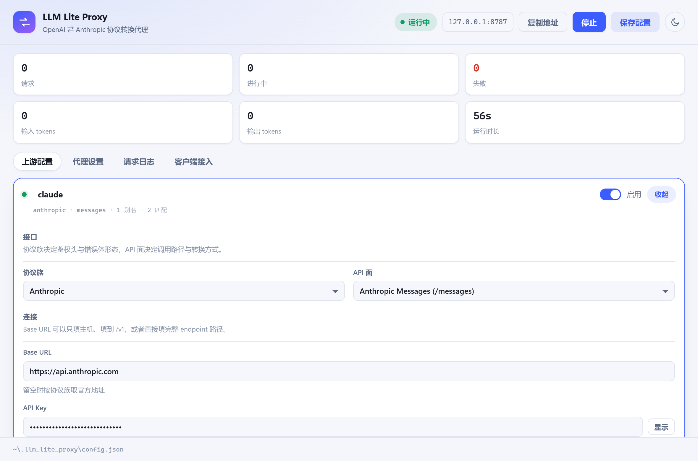

# LLM Lite Proxy

**English** · [中文](README.md)

A **two-way OpenAI ⇄ Anthropic protocol proxy** that runs on your own machine, with a configuration window.
Fill in the upstream, fill in the key, press Start. From then on either side works no matter which protocol it speaks: a client can hit Claude through `/v1/chat/completions`, or hit GPT through `/v1/messages`, without changing a single line of client code.

> **This is a pure LLM proxy tool.** No accounts, no cloud service, no database, no background jobs, and no retries, round-robin or load balancing.
> It does one thing: translate the request body from one protocol into the other, then translate the response back. All the code is in this repository, and the backend is pure Rust.


---

## When you need it

| Scenario | Without it | With it |
| --- | --- | --- |
| Claude Code / Anthropic SDK wants a GPT upstream | The client does not support it and cannot be changed | Point `ANTHROPIC_BASE_URL` at this machine; the proxy converts to Chat Completions |
| An OpenAI SDK project wants to switch to Claude | After changing `base_url` the request body no longer matches | Point it at `/v1` on this machine; the proxy converts to Messages |
| The gateway only exposes `/v1/responses` (Codex and friends) | Hand-write a layer of conversion | Pick any of the three inbound surfaces; any upstream kind works |
| You want to know why some parameter had no effect | Packet capture | The request log lists the dropped parameters and the raw upstream response directly |

## Features

- **One process, three inbound endpoints**: `/v1/chat/completions`, `/v1/responses`, `/v1/messages`
- **Two-level protocol description**: protocol family (`openai` / `anthropic`, decides the auth headers and the error body) + API surface (`chat` / `responses` / `messages`, decides the path and the conversion). Give only the family and the surface defaults are filled in per family
- **Streaming converted chunk by chunk**, not buffered until complete: Anthropic's `content_block_delta` / `input_json_delta` and OpenAI's `delta.content` / `delta.tool_calls[].function.arguments` are converted both ways
- **Three-way tool-call conversion**, including sanitizing invalid tool names and restoring them on the response side; **thinking blocks** (`thinking` / `reasoning_content`) and their signatures mapped both ways
- **Model routing**: alias mapping, `provider/model` prefix for direct targeting, glob patterns matched in order, fallback upstream
- **Client authentication**: both `Authorization: Bearer` and `x-api-key` are accepted; leave the upstream key empty and the client's key is forwarded unchanged (pure protocol-shell usage)
- **Live request log**: status code, protocol path, model, tokens, total duration, time to first chunk, dropped parameters, raw upstream response
- **Same-surface passthrough**: when the inbound surface equals the upstream surface only the model name is rewritten, and client-native parameters (`top_k`, `store`, `reasoning.summary`) are kept as they are
- **Cross-platform desktop shell**: Tauri 2 + WebView, one codebase for Windows / macOS / Linux
- Zero Python and zero Node in the backend: `axum` + `reqwest` + `tokio`

## 30-second start


1. **Install**: grab the installer for your platform from [Releases](https://github.com/bluebirds37/llm_lite_proxy/releases) and double-click it; or from source, `npm install && npx tauri dev`.
2. **Fill in the upstreams**: open *Upstream configuration*. The first time it is empty — clicking **"Fill in two examples"** generates a `claude` and an `openai` card, and you only have to add the keys; start from scratch with *Add one manually* instead.
3. **Start**: click *Start* in the top-right corner; it listens on `http://127.0.0.1:8787` by default. Changes are saved automatically once you stop typing, so there is no save button to press.
4. **Connect a client**: open *Client access*, copy the snippet you need and paste it into a terminal.

```bash
# Claude Code
export ANTHROPIC_BASE_URL=http://127.0.0.1:8787
export ANTHROPIC_API_KEY=<your-proxy-key>

# Any OpenAI-compatible client
export OPENAI_BASE_URL=http://127.0.0.1:8787/v1
export OPENAI_API_KEY=<your-proxy-key>
```

## Install and uninstall

The Windows installer is a single NSIS file, `LLM Lite Proxy_x.y.z_x64-setup.exe`. After installing there are two one-click ways to remove it: the **"Uninstall LLM Lite Proxy"** shortcut in the Start menu, and the Uninstall button under *Settings → Apps → Installed apps* — neither requires running the installer again.

The uninstall confirmation page carries a **"Delete the application data"** check box:

| Checked | Behaviour |
| --- | --- |
| No | Only the program files and shortcuts go; the configuration in `~/.llm_lite_proxy` stays, so a reinstall picks up where you left off |
| Yes | `~/.llm_lite_proxy` is deleted too (upstream addresses and keys are erased with it) |

Silent command-line use works as well: `LLM Lite Proxy_x64-setup.exe /S` to install and `"%LOCALAPPDATA%\LLM Lite Proxy\uninstall.exe" /S` to remove (silent mode shows no confirmation page and keeps the configuration folder). It is a per-user install: files land in `%LOCALAPPDATA%\LLM Lite Proxy` and no administrator rights are needed.

## A tour of the interface

### Upstream configuration

Each upstream is a card: the card header lets you rename it inline, shows the protocol summary and carries the enable switch; clicking the card (or its *Configure* button) expands the full form in place, and the opened card takes the whole row. The dashed card at the end is *Add upstream*.


One upstream is one model service. The **protocol family** is which protocol the upstream itself speaks, independent of what the client speaks; the **API surface** decides the call path. The Base URL can be just the host, the host down to `/v1`, or the full endpoint path; left empty it falls back to the official address of that family.



Everything you can set is on this page: the enabled switch, match patterns (glob), the model alias table (`public → upstream`), and extra request headers (the `anthropic-version`, `User-Agent` and similar that gateways require). *Test connection* sends one real request using what is currently in the form; you do not need to save first.

### Proxy settings

Listen address, port, client keys, fallback upstream, default `max_tokens`, overall request timeout, stream idle timeout, request body limit, number of log entries kept, browser origins allowed to call cross-origin, plus two switches (forward unrecognized parameters / ask OpenAI upstreams for a usage block).


The status line at the top shows the **address actually being listened on**, and flags it when it differs from the values in the inputs (changing the address, the port or the body limit restarts the listener and cuts requests in flight; every other field takes effect hot on save).

### Request logs

Every request lands in the table live: time, status, upstream, protocol path, model, input/output tokens, duration, flags (streaming, time to first chunk), error.


**Click any row to expand it** and you get the raw upstream response, the parameters the conversion dropped, and a note — no packet capture needed to debug mapping problems. The *All / Failed only / Streaming only* controls on top are filters, and the six numbers in the top-right corner are running totals.

### Client access

Snippets generated from the current address and key, ready to copy: Claude Code / Anthropic SDK, Codex / OpenAI SDK, Responses clients, and two curl commands (including Anthropic streaming against a GPT upstream).


### Theme

The round button in the top-right corner switches between light and dark, following the system by default; the choice lives in the WebView's localStorage, not in the configuration file, so a reinstall on another machine does not carry it over. The title bar follows along, and each platform does it differently:

| Platform | Title bar |
| --- | --- |
| Windows 11 | Immersive dark mode plus `DWMWA_CAPTION_COLOR` / `DWMWA_TEXT_COLOR` so the caption takes the header's background and text colour and reads as the same strip; Windows 10 has no caption-colour API and only follows the light/dark switch |
| macOS | Overlay title bar: the window title is hidden, the page runs under the title bar and the traffic lights float over the left of the app header (the header reserves 88px and a drag band for them) |
| Linux | No equivalent API — the title bar belongs to the GTK theme, so only the light/dark switch carries over |

Only the Windows path has actually been looked at on this machine; the macOS overlay configuration compiles and ships through CI, but nobody has opened it on a Mac.


## Conversion topology


Internally there is only one representation, Chat Completions, and each API surface keeps exactly one bridge to it, so all 3 inbound surfaces × 2 upstream kinds work. The field-level mapping rules (including how each vendor's usage buckets are added up and subtracted, the `stop_reason` cross-reference table, and which parameters get dropped) are in **[docs/conversion-rules.en.md](docs/conversion-rules.en.md)**.

## Configuration file

There is a single configuration location, the same on all three platforms: **`~/.llm_lite_proxy/config.json`** (on Windows that is `%USERPROFILE%\.llm_lite_proxy\config.json`). The first launch writes a file containing examples there. JSON takes no comments, so the field meanings are in the table below.

Older builds used TOML, and kept it in the per-platform app-data directory (on Windows, `%APPDATA%\com.llmliteproxy.desktop\config.toml`). When there is no `config.json` at the new location at startup, the app looks in order for `~/.llm_lite_proxy/config.toml`, then `config.json` and `config.toml` in the old app-data directory, and carries the first one it can parse over as JSON — no manual copying.

The bottom of the window also shows the path currently being read and written. The full shape:

```json
{
  "server": {
    "host": "127.0.0.1",
    "port": 8787,
    "master_keys": ["<your-proxy-key>"],
    "default_provider": "claude",
    "default_max_tokens": 4096,
    "passthrough_unknown_params": false,
    "openai_include_usage": true,
    "request_timeout_secs": 600,
    "stream_idle_timeout_secs": 120,
    "max_body_mb": 64,
    "log_capacity": 400,
    "allow_origins": []
  },
  "providers": [
    {
      "name": "claude",
      "protocol": "anthropic",
      "api": "messages",
      "base_url": "https://api.anthropic.com",
      "api_key": "<your-upstream-key>",
      "enabled": true,
      "patterns": ["claude*", "sonnet*"],
      "models": [
        { "public": "claude-pro", "upstream": "claude-sonnet-4-5" }
      ],
      "headers": {}
    },
    {
      "name": "openai",
      "protocol": "openai",
      "base_url": "https://api.openai.com/v1",
      "api_key": "<your-upstream-key>",
      "patterns": ["gpt-*"]
    }
  ]
}
```

Every field except `providers[].name` and `protocol` may be omitted (the second entry above does), and the defaults are the ones listed here:

| Field | Meaning | Default |
| --- | --- | --- |
| `server.host` / `server.port` | Listen address and port; changing them restarts the listener and cuts requests in flight | `127.0.0.1` / `8787` |
| `server.master_keys` | Keys the client must send (`Authorization: Bearer` or `x-api-key`) | empty, i.e. no check |
| `server.default_provider` | Fallback upstream | none |
| `server.default_max_tokens` | Used when the client sends no `max_tokens` | `4096` |
| `server.passthrough_unknown_params` | When `true`, parameters this project does not know are forwarded as they are | `false` |
| `server.openai_include_usage` | Ask OpenAI upstreams for a usage block | `true` |
| `server.request_timeout_secs` | Overall timeout for one request | `600` |
| `server.stream_idle_timeout_secs` | How long a stream may go without bytes before it counts as broken | `120` |
| `server.max_body_mb` | Request body limit; changing it restarts the listener | `64` |
| `server.log_capacity` | Number of log entries kept | `400` |
| `server.allow_origins` | Browser origins allowed to call cross-origin, `["*"]` means all | empty, so browsers are blocked |
| `providers[].protocol` | `openai` or `anthropic`; decides the auth headers and the error body | required |
| `providers[].api` | `chat` / `responses` / `messages`; decides the call path | filled in per family |
| `providers[].base_url` | May be just the host, the host down to `/v1`, or the full endpoint path | the official address of that family |
| `providers[].api_key` | Upstream key; left empty, the client's key is forwarded | empty |
| `providers[].enabled` | A disabled upstream takes no part in routing | `true` |
| `providers[].patterns` | Glob patterns, matched in order | empty |
| `providers[].models` | Exact aliases `public → upstream`, taking priority over `patterns` | empty |
| `providers[].headers` | Headers appended to every upstream request, e.g. `{"anthropic-version": "2023-06-01"}` | empty |

## Running from source

Prerequisites: **Rust** (stable, MSVC toolchain on Windows), **Node 18+**, and Tauri 2's system dependencies.

```bash
npm install

npx tauri dev      # development: window + vite hot reload (http://localhost:1420)
npx tauri build    # build the installers
cargo test --workspace --exclude desktop   # run only the protocol-layer and proxy-layer tests
```

Bundled artifacts per platform:

| Platform | Command | Artifact | Verification |
| --- | --- | --- | --- |
| Windows | `npx tauri build --bundles nsis` | `target/release/bundle/nsis/*_x64-setup.exe` | Tested on this machine |
| Windows (MSI) | `npx tauri build --bundles msi` | `target/release/bundle/msi/*.msi` | Built in CI; locally it needs the WiX Toolset downloaded first |
| macOS | `npx tauri build --bundles dmg,app` | `target/release/bundle/macos/*.app`, `dmg/*_aarch64.dmg` | Builds in CI (Apple Silicon runner, arm64); never run on real hardware |
| Linux | `npx tauri build --bundles deb,appimage` | `target/release/bundle/{deb,appimage}/` | Builds in CI; never run on real hardware |

All three platforms have built green in CI repeatedly (since 2026-10-20, most recently on the commit being released); "never launched on real hardware" means nobody actually installed and clicked through the result on macOS / Linux — those are different claims. macOS / Linux system dependencies and CI packaging: see **[docs/build.en.md](docs/build.en.md)**.

## Project layout

A standard Tauri 2 layout: the repository root is the frontend, `src-tauri/` is the desktop shell, and the business logic lives in `crates/` as workspace members.

```
.
├── index.html            frontend entry
├── src/                  frontend (TypeScript + plain DOM, no framework)
│   ├── main.ts           rendering of the four panels and autosave
│   ├── logs.ts           request log table
│   ├── theme.ts          light / dark
│   └── styles.css
├── src-tauri/            Tauri 2 shell
│   ├── src/lib.rs        starts and stops the proxy in-process, command layer, config read/write
│   ├── nsis-hooks.nsh    Windows install/uninstall hooks (optional config-folder removal)
│   ├── tauri.conf.json
│   ├── capabilities/
│   └── icons/
├── crates/
│   ├── protocol/         pure protocol layer: three sets of wire types + request/response/streaming converters
│   │                     no IO, no async, no HTTP dependency; tests run in milliseconds
│   └── proxy/            axum routing, JSON config and validation, model routing,
│                         reqwest upstream, SSE pipeline, log bus
├── docs/                 documentation and images
└── Cargo.toml            workspace: crates/* + src-tauri
```

`protocol` is a crate of its own so that testing the conversion logic does not drag in the Tauri dependency tree.

## Known limits

- The only upstream protocol families are OpenAI-compatible and Anthropic-compatible; there is no native signing for Bedrock / Vertex / Gemini.
- Responses ⇄ Messages goes through Chat Completions as an intermediate, so the semantic gap between the two mappings (for instance Responses' `reasoning.encrypted_content` versus Anthropic's thinking signature) is not converted faithfully; the history involved is dropped and recorded in the log.
- No retries, no load balancing, no round-robin over multiple keys; one request hits one upstream only.
- Keys are stored in plaintext in the local config.json, and the desktop side returns them as-is when reading them back for the UI — this is for self use, and the machine's file permissions are the boundary.
- **The interface text is Chinese-only today** (the screenshots in this repository show the Chinese UI); protocol fields, configuration keys and log contents are unaffected.
- **It is only safe while listening on a loopback address**; if you switch to `0.0.0.0`, make sure `master_keys` is set.

## License

[MIT](LICENSE) · [Changelog](CHANGELOG.md). The implementation follows field mapping rules worked out from [litellm](https://github.com/BerriAI/litellm), but this is an independent Rust implementation and does not depend on litellm.
