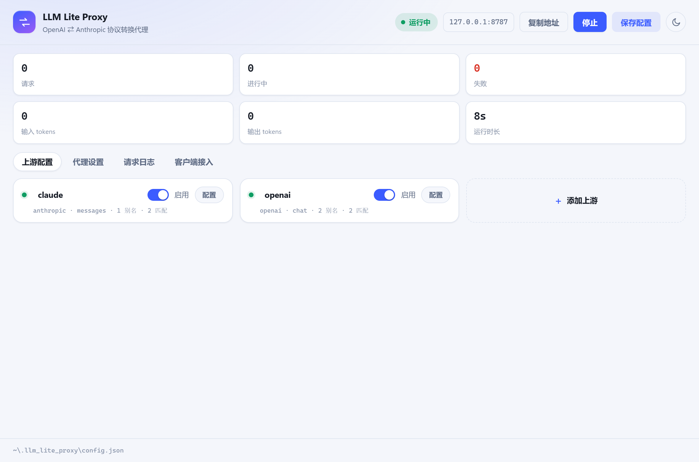
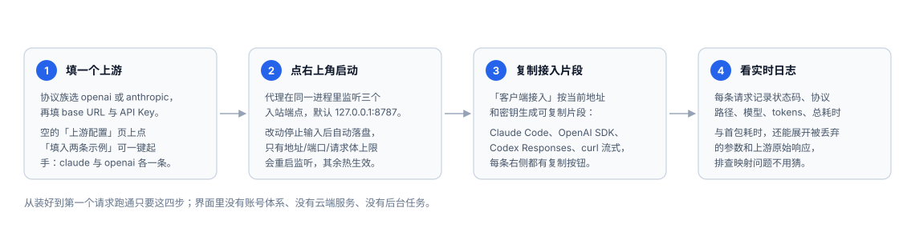
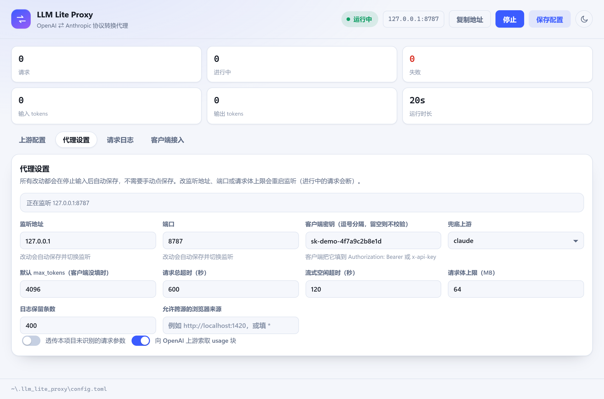
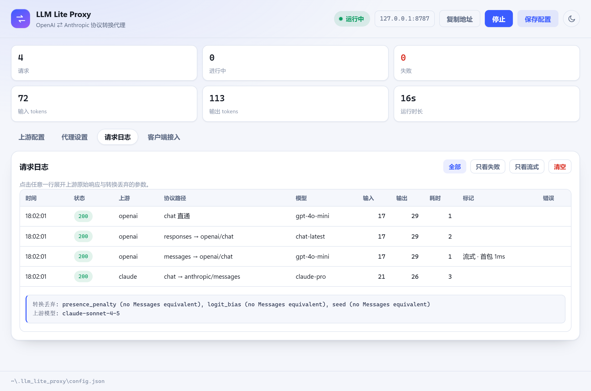
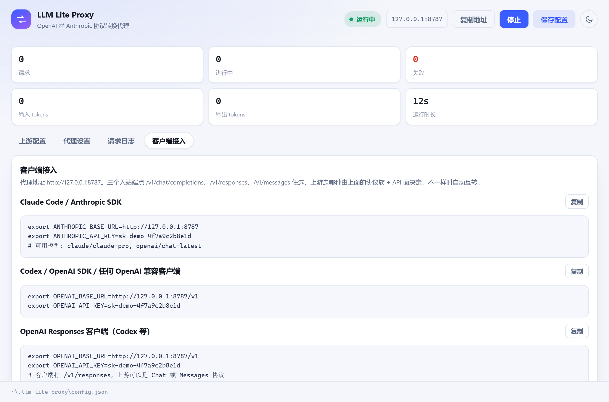
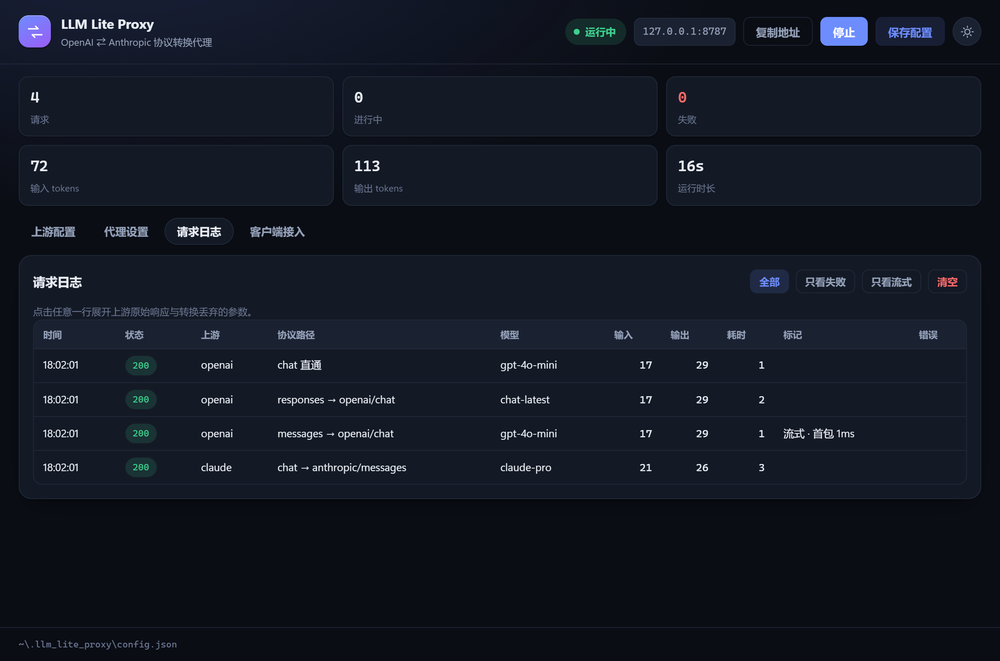
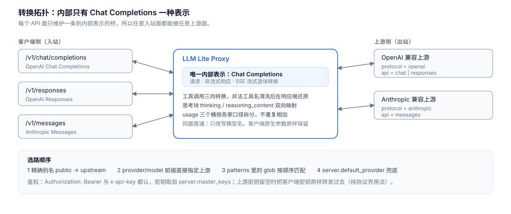

# LLM Lite Proxy

**中文** · [English](README.en.md)

一个跑在你本机的 **OpenAI ⇄ Anthropic 协议互转代理**，带一个配置窗口。
填上游、填 Key、点启动，之后任何一边说哪种协议都能通：客户端用 `/v1/chat/completions` 打 Claude，或者用 `/v1/messages` 打 GPT，都不需要改一行客户端代码。

> **这是一个纯粹的大模型代理工具。** 没有账号体系、没有云端服务、没有数据库、没有后台任务，也不做重试、轮询和负载均衡。
> 它只做一件事：把请求体从一种协议翻译成另一种，再把响应翻译回来。全部代码都在这个仓库里，后端是纯 Rust。



---

## 你需要它的时候

| 场景 | 没有它 | 有它 |
| --- | --- | --- |
| Claude Code / Anthropic SDK 想用 GPT 上游 | 客户端不支持，改不了 | 把 `ANTHROPIC_BASE_URL` 指到本机，代理转成 Chat Completions |
| OpenAI SDK 项目想切到 Claude | 改 `base_url` 之后请求体对不上 | 指到本机 `/v1`，代理转成 Messages |
| 网关只暴露 `/v1/responses`（Codex 一类） | 手写一层转换 | 三个入站面任选，上游哪种都行 |
| 想知道某个参数为什么没生效 | 抓包 | 请求日志直接列出被丢弃的参数与上游原始响应 |

## 特性

- **一个进程三个入站端点**：`/v1/chat/completions`、`/v1/responses`、`/v1/messages`
- **两级协议描述**：协议族（`openai` / `anthropic`，决定鉴权头与错误体）+ API 面（`chat` / `responses` / `messages`，决定路径与转换）。只写协议族时按族补默认面
- **流式逐块转换**，不是攒齐再发：Anthropic 的 `content_block_delta` / `input_json_delta` 与 OpenAI 的 `delta.content` / `delta.tool_calls[].function.arguments` 互转
- **工具调用三向转换**，含非法工具名清洗与响应端还原；**思考块**（`thinking` / `reasoning_content`）与签名双向映射
- **模型路由**：别名映射、`provider/model` 前缀直指、glob 模式按序匹配、兜底上游
- **客户端鉴权**：`Authorization: Bearer` 与 `x-api-key` 都认；上游 Key 留空则把客户端 Key 原样转发（纯协议壳用法）
- **实时请求日志**：状态码、协议路径、模型、tokens、总耗时、首包耗时、被丢弃的参数、上游原始响应
- **同面直通**：入站面与上游面一致时只改写模型名，客户端原生参数（`top_k`、`store`、`reasoning.summary`）原样保留
- **跨平台桌面壳**：Tauri 2 + WebView，Windows / macOS / Linux 同一套代码
- 后端零 Python、零 Node：`axum` + `reqwest` + `tokio`

## 30 秒上手



1. **装**：从 [Releases](https://github.com/bluebirds37/llm_lite_proxy/releases) 下载对应平台的安装包，双击安装；或者从源码 `npm install && npx tauri dev`。
2. **填上游**：打开「上游配置」。第一次是空的，点 **「填入两条示例」** 会生成 `claude` 与 `openai` 两张卡片，把 Key 填上即可；想从零开始就点「手动添加一个」。
3. **启动**：右上角点「启动」，默认监听 `http://127.0.0.1:8787`。改动停止输入后会自动保存，不需要手动点保存。
4. **接客户端**：打开「客户端接入」，复制对应片段贴进终端就完事。

```bash
# Claude Code
export ANTHROPIC_BASE_URL=http://127.0.0.1:8787
export ANTHROPIC_API_KEY=<你的代理密钥>

# 任何 OpenAI 兼容客户端
export OPENAI_BASE_URL=http://127.0.0.1:8787/v1
export OPENAI_API_KEY=<你的代理密钥>
```

## 安装与卸载

Windows 安装包是 NSIS 生成的单文件 `LLM Lite Proxy_x.y.z_x64-setup.exe`。装完有两个一键卸载入口：开始菜单里的 **「卸载 LLM Lite Proxy」** 快捷方式，和「设置 → 应用 → 安装的应用」里的卸载按钮——都不需要再跑一遍安装程序。

卸载确认页上有一个 **「删除应用程序数据」** 复选框：

| 勾选 | 行为 |
| --- | --- |
| 不勾 | 只删程序文件与快捷方式，`~/.llm_lite_proxy` 里的配置原样保留，重装即恢复 |
| 勾选 | 连 `~/.llm_lite_proxy` 一起删除（上游地址与密钥一并清掉） |

命令行静默安装/卸载同样可用：`LLM Lite Proxy_x64-setup.exe /S` 安装，`"%LOCALAPPDATA%\LLM Lite Proxy\uninstall.exe" /S` 卸载（静默模式不弹确认页，默认保留配置目录）。per-user 安装，程序文件落在 `%LOCALAPPDATA%\LLM Lite Proxy`，不需要管理员权限。

## 界面导览

### 上游配置

一个上游就是一个模型服务。**协议族**选它自己说哪种协议，跟客户端用哪种无关；**API 面**决定调用路径。Base URL 可以只填主机、填到 `/v1`，或者直接填完整 endpoint 路径，留空则取该协议族的官方地址。


每个上游是一张卡片：卡片头上能直接改名、看到协议摘要、开关启用状态；点卡片（或右侧的「配置」按钮）就地展开完整表单，展开的那一张会占满整行，最后一张虚线卡片是「添加上游」。

可填的东西都在这一页：启用开关、匹配模式（glob）、模型别名表（`public → upstream`）、附加请求头（网关要求的 `anthropic-version`、`User-Agent` 之类）。「测试连通」按当前填写的内容打一次真实请求，不用先保存。

### 代理设置

监听地址、端口、客户端密钥、兜底上游、默认 `max_tokens`、请求总超时、流式空闲超时、请求体上限、日志保留条数、允许跨源的浏览器来源，以及两个开关（透传未识别参数 / 向 OpenAI 上游索取 usage 块）。



顶部那条状态会显示**当前实际监听的地址**，和输入框里的值不一致时会标出来（改地址、端口或请求体上限会重启监听，进行中的请求会断；其余字段保存即热生效）。

### 请求日志

每条请求实时进表：时间、状态、上游、协议路径、模型、输入/输出 tokens、耗时、标记（流式、首包耗时）、错误。



**点任意一行展开**，能看到上游原始响应、被转换丢弃的参数和备注——排查映射问题不用抓包。顶部的「全部 / 只看失败 / 只看流式」是过滤器，右上角六个数字是累计统计。

### 客户端接入

按当前地址与密钥生成可直接复制的片段：Claude Code / Anthropic SDK、Codex / OpenAI SDK、Responses 客户端，以及两条 curl（含 Anthropic 流式打 GPT 上游）。



### 主题

右上角的圆形按钮在浅色与深色之间切换，默认跟随系统。切换时**窗口标题栏会跟着一起变**（Windows 走 DWM 的沉浸式深色标题栏，实测过；macOS / Linux 由同一套 Tauri 接口处理，未实测），不会出现深色面板顶在浅色标题栏下面的情况。选择记在 WebView 的 localStorage 里，不进配置文件——换机器重装不会带过去。



## 转换拓扑



内部只有 Chat Completions 一种表示，每个 API 面只维护一条到它的桥，所以 3 个入站面 × 2 类上游全都通。字段级的映射规则（含各家 usage 桶怎么加怎么减、`stop_reason` 对照表、哪些参数会被丢弃）见 **[docs/conversion-rules.md](docs/conversion-rules.md)**。

## 配置文件

配置只有一个位置，三个平台都一样：**`~/.llm_lite_proxy/config.json`**（Windows 上即 `%USERPROFILE%\.llm_lite_proxy\config.json`）。首次启动会在这里写一份带示例的配置；JSON 不能写注释，字段含义看下面那张表。

再早一点的版本用 TOML，而且放在各平台自己的 app-data 目录（Windows 是 `%APPDATA%\com.llmliteproxy.desktop\config.toml`）。启动时如果新位置没有 `config.json`，会依次找 `~/.llm_lite_proxy/config.toml`、旧 app-data 目录里的 `config.json` 与 `config.toml`，取第一个能解析出来的搬过来并写成 JSON，不需要手动复制。

界面底部也会显示当前实际读写的路径。完整结构：

```json
{
  "server": {
    "host": "127.0.0.1",
    "port": 8787,
    "master_keys": ["<你的代理密钥>"],
    "default_provider": "claude",
    "default_max_tokens": 4096,
    "passthrough_unknown_params": false,
    "openai_include_usage": true,
    "request_timeout_secs": 600,
    "stream_idle_timeout_secs": 120,
    "max_body_mb": 64,
    "log_capacity": 400,
    "allow_origins": []
  },
  "providers": [
    {
      "name": "claude",
      "protocol": "anthropic",
      "api": "messages",
      "base_url": "https://api.anthropic.com",
      "api_key": "<你的上游密钥>",
      "enabled": true,
      "patterns": ["claude*", "sonnet*"],
      "models": [
        { "public": "claude-pro", "upstream": "claude-sonnet-4-5" }
      ],
      "headers": {}
    },
    {
      "name": "openai",
      "protocol": "openai",
      "base_url": "https://api.openai.com/v1",
      "api_key": "<你的上游密钥>",
      "patterns": ["gpt-*"]
    }
  ]
}
```

除 `providers[].name` 与 `protocol` 之外每个字段都能省略（上面第二条 `openai` 就是这样），缺省值即下表标注：

| 字段 | 含义 | 缺省 |
| --- | --- | --- |
| `server.host` / `server.port` | 监听地址与端口；改动会重启监听，进行中的请求会断 | `127.0.0.1` / `8787` |
| `server.master_keys` | 客户端要带的密钥（`Authorization: Bearer` 或 `x-api-key`） | 空，即不校验 |
| `server.default_provider` | 兜底上游 | 无 |
| `server.default_max_tokens` | 客户端没填 `max_tokens` 时补这个 | `4096` |
| `server.passthrough_unknown_params` | `true` 时把本项目不认识的参数原样转发 | `false` |
| `server.openai_include_usage` | 向 OpenAI 上游索取 usage 块 | `true` |
| `server.request_timeout_secs` | 单次请求总超时 | `600` |
| `server.stream_idle_timeout_secs` | 流式响应多久没字节算断 | `120` |
| `server.max_body_mb` | 请求体上限；改动会重启监听 | `64` |
| `server.log_capacity` | 日志保留条数 | `400` |
| `server.allow_origins` | 允许跨源的浏览器来源，`["*"]` 表示全部 | 空，即浏览器不可跨源 |
| `providers[].protocol` | `openai` 或 `anthropic`，决定鉴权头与错误体 | 必填 |
| `providers[].api` | `chat` / `responses` / `messages`，决定调用路径 | 按协议族补 |
| `providers[].base_url` | 可只填主机、填到 `/v1`，或直接填完整 endpoint 路径 | 该协议族官方地址 |
| `providers[].api_key` | 上游密钥；留空则把客户端密钥原样转发 | 空 |
| `providers[].enabled` | 关掉后不参与选路 | `true` |
| `providers[].patterns` | 按顺序匹配的 glob | 空 |
| `providers[].models` | 精确别名 `public → upstream`，优先级高于 `patterns` | 空 |
| `providers[].headers` | 附加到每次上游请求，如 `{"anthropic-version": "2023-06-01"}` | 空 |

## 从源码运行

前置：**Rust**（stable，Windows 上 MSVC 工具链）、**Node 18+**、Tauri 2 的系统依赖。

```bash
npm install

npx tauri dev      # 开发：窗口 + vite 热更新（http://localhost:1420）
npx tauri build    # 打安装包
cargo test --workspace --exclude desktop   # 只跑协议层与代理层测试
```

各平台的打包产物：

| 平台 | 命令 | 产物 | 验证 |
| --- | --- | --- | --- |
| Windows | `npx tauri build --bundles nsis` | `target/release/bundle/nsis/*_x64-setup.exe` | 本机实测 |
| Windows (MSI) | `npx tauri build --bundles msi` | `target/release/bundle/msi/*.msi` | CI 产出过；本机要先联网装 WiX |
| macOS | `npx tauri build --bundles dmg,app` | `target/release/bundle/macos/*.app`、`dmg/*_aarch64.dmg` | CI 构建通过（Apple Silicon runner，arm64），未实机运行 |
| Linux | `npx tauri build --bundles deb,appimage` | `target/release/bundle/{deb,appimage}/` | CI 构建通过，未实机运行 |

三平台的 CI 构建已在 2026-10-20 跑通一次；「未实机运行」指没人真的在 macOS / Linux 上装起来点过，两者不是一回事。macOS / Linux 的系统依赖与 CI 出包见 **[docs/build.md](docs/build.md)**。

## 项目结构

标准的 Tauri 2 布局：仓库根是前端，`src-tauri/` 是桌面壳，业务逻辑在 `crates/` 里作为 workspace 成员。

```
.
├── index.html            前端入口
├── src/                  前端（TypeScript + 原生 DOM，无框架）
│   ├── main.ts           四个面板的渲染与自动保存
│   ├── logs.ts           请求日志表格
│   ├── theme.ts          浅色 / 深色
│   └── styles.css
├── src-tauri/            Tauri 2 壳
│   ├── src/lib.rs        进程内启停代理、命令层、配置读写
│   ├── nsis-hooks.nsh    Windows 安装/卸载钩子（卸载时可选删配置目录）
│   ├── tauri.conf.json
│   ├── capabilities/
│   └── icons/
├── crates/
│   ├── protocol/         纯协议层：三套 wire 类型 + 请求/响应/流式转换器
│   │                     无 IO、无 async、无 HTTP 依赖，测试是毫秒级
│   └── proxy/            axum 路由、JSON 配置与校验、模型路由、
│                         reqwest 上游、SSE 管道、日志总线
├── docs/                 文档与图片
└── Cargo.toml            workspace：crates/* + src-tauri
```

`protocol` 单独成 crate 是为了让转换逻辑的测试不牵扯 Tauri 依赖树。

## 已知边界

- 上游协议族只有 OpenAI 兼容与 Anthropic 兼容两类，没有 Bedrock / Vertex / Gemini 的原生签名。
- Responses ⇄ Messages 经 Chat Completions 中转，两次映射之间的语义间隙（如 Responses 的 `reasoning.encrypted_content` 与 Anthropic 的 thinking 签名）不做保真转换，相关历史会被丢弃并记进日志。
- 没有重试、负载均衡和多 Key 轮询；一个请求只打一个上游。
- Key 以明文存在本机 config.json，桌面端读回时也原样返回给界面——自用场景，机器权限即边界。
- **界面文案目前只有中文**（本仓库的截图也都是中文界面）；协议字段、配置键名与日志内容不受影响。
- **只监听回环地址时才算安全**；改成 `0.0.0.0` 请务必设置 `master_keys`。

## 许可

[MIT](LICENSE)。实现参考了 [litellm](https://github.com/BerriAI/litellm) 的字段映射规则，但这是独立的 Rust 实现，不依赖 litellm。
